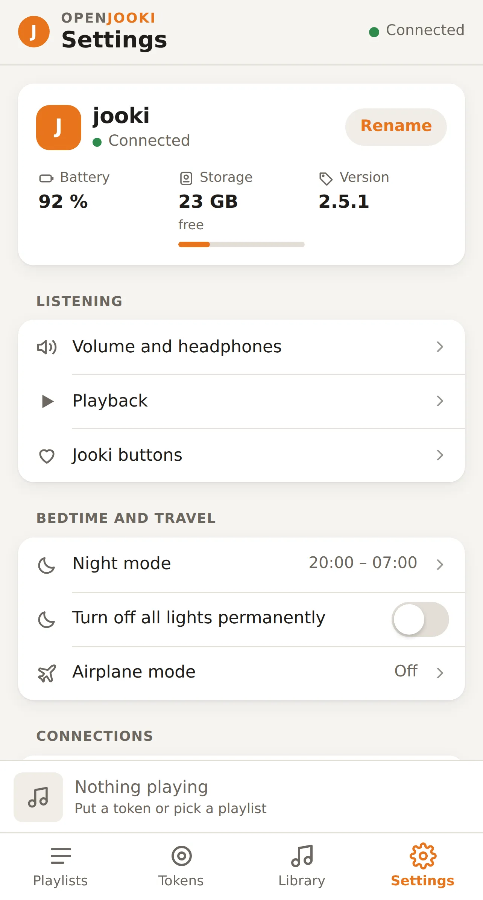

# Update it

When a new version is out, the Jooki's page shows **Update … available**. Tap **Show**,
then **Update now**, and confirm.

1. Keep the Jooki **plugged in**.
2. The page shows the steps: looking for the new version, downloading, checking,
   installing, restarting. Count ten to twenty minutes.
3. The Jooki restarts on its own. The page finds it again by itself and says
   **Jooki updated**.

**The page seems stuck?** During the update the Jooki disconnects and comes back, and a
phone that went to sleep can lose track. After three minutes without anything moving, the
page offers **Reload the page**: it stops nothing. (Before version 2.2.7 the page did not
say so: just reload it yourself.)

No message? *Settings → Update → **Check for updates***.

**Good to know**
- Your music and tokens are never touched by an update.
- If the new version does not start properly, give it five minutes: the Jooki goes back to the
  previous one by itself.

What changed in each version: [CHANGELOG](../CHANGELOG.md).

## Offline test branch

The fork's `main` contains the experimental Spotify changes. A Jooki built from
this source checks `dirkdrutschmann/openjooki` for firmware releases, separately
from the original project's releases. A source commit does not update the device:
the normal updater needs a complete firmware image and `version.json` published as
a GitHub Release by `scripts/publish-release.sh`.

The `2.4.21-offline.N` test packages remain separate from full firmware releases.
They include the web page, Lua core and an SD-resident player; credentials and music
are excluded. Use the matching installer and retain its private rollback state.
See [the test setup and login guide](spotify-offline.de.md),
[the package/rollback commands](../tools/spotify-offline/README.md) and
[the fork release steps](../docs/28-release.md).

[← Back](../README.md)
